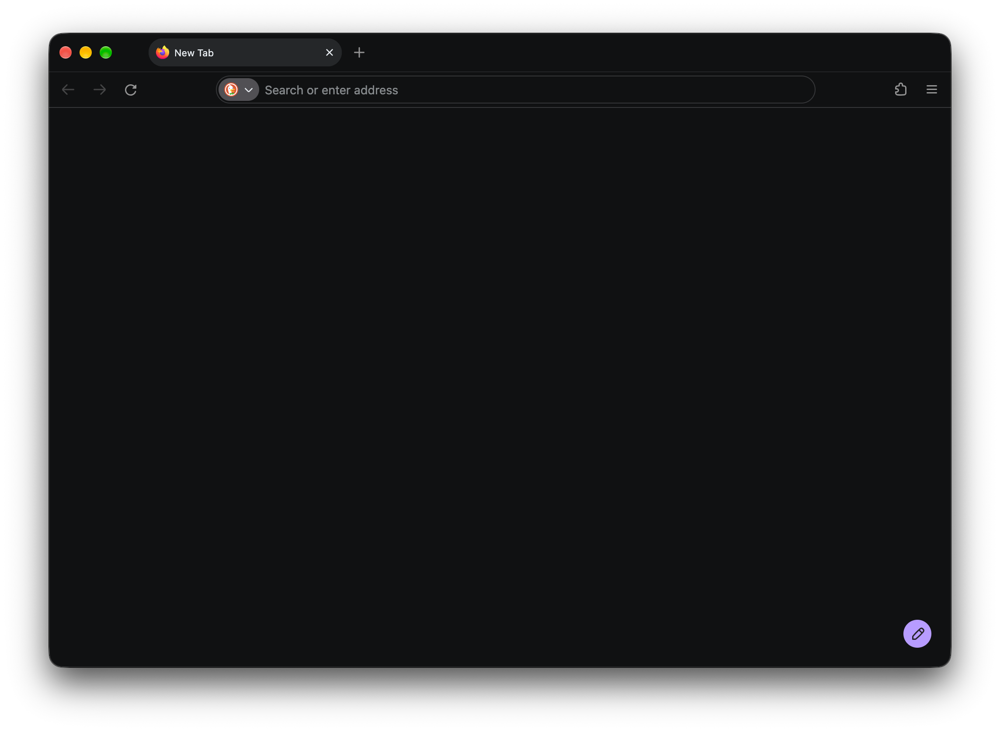

<h1 align="center">Outline Dark</h1>

<p align="center">Dark Firefox theme with toolbar outlines and a filled active tab</p>



## Build

```sh
zip --junk-paths outline-dark.xpi manifest.json
```

## Credits

Color palette adapted from [GitHub Dark Default Faded](https://addons.mozilla.org/en-US/firefox/addon/github-dark-default-faded/) by Sun Knudsen ([CC BY 4.0](https://creativecommons.org/licenses/by/4.0/)).

## License

[Creative Commons Attribution 4.0 International](LICENSE)
